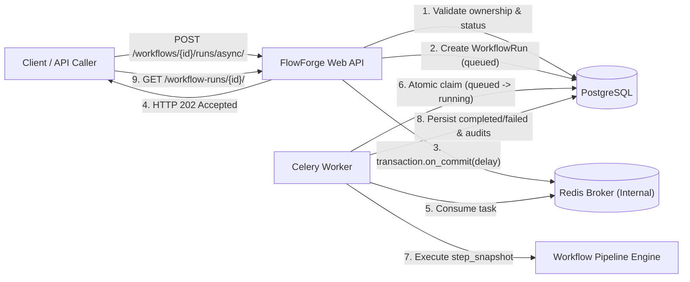

# FlowForge

[](https://github.com/amitworx/flowforge/actions/workflows/ci.yml)
[](LICENSE)

FlowForge is an open-source, self-hostable Python document-processing and workflow automation platform. Its core is designed to run reliably without requiring any LLM or paid cloud AI services.

---

> [!WARNING]
> **Development vs. Production Notice:**
> The provided `docker-compose.yml`, `Dockerfile`, Django `runserver`, `.env.example`, and sample credentials (`SECRET_KEY`, `flowforge` database password, and sample credentials like `devuser:devpass123`) are **strictly for local development and testing only**.
> - **Authentication Security:** HTTP Basic Authentication (`Authorization: Basic ...`) transmits credentials encoded in Base64 (unencrypted). In local development over `localhost` / `127.0.0.1`, this is acceptable for rapid testing. Outside local development, **Basic Authentication strictly requires TLS/HTTPS** or a secure session/token infrastructure to prevent credential interception.
> - **Environment Validation:** In `production` or `staging` environments, the application **strictly rejects** the sample/insecure secret key, refuses to start if `DEBUG=True`, and rejects default database credentials.
> - **Port Hardening:** PostgreSQL in `docker-compose.yml` is hardened by default to bind only to `127.0.0.1` (localhost), preventing accidental exposure to the host network or public internet.
> - Never deploy to production using development configurations or sample secrets.

---

## Architectural Overview

- **Core Engine:** Django 5.2 (LTS) & Django REST Framework (DRF)
- **Database:** PostgreSQL 17 (via `psycopg` 3)
- **Configuration:** Typed configuration via `pydantic-settings` with strict environment-mode validation
- **Ingestion Engine:** Synchronous, deterministic CSV/JSON processing with safe multi-layer bounding and normalization
- **Linting & Formatting:** Ruff
- **Test Suite:** pytest with `pytest-django`

### API Layout
- Versioned API base: `/api/v1/`
- Health check endpoint: `GET /api/v1/health/`
- Ingestion jobs endpoint: `POST /api/v1/jobs/` (Authenticated)
- List user jobs: `GET /api/v1/jobs/` (Authenticated)
- Retrieve job metadata: `GET /api/v1/jobs/{uuid}/` (Authenticated)
- Download normalized JSON: `GET /api/v1/jobs/{uuid}/download/` (Authenticated)
- Create workflow definition: `POST /api/v1/workflows/` (Authenticated)
- List workflow definitions: `GET /api/v1/workflows/` (Authenticated)
- Retrieve workflow definition: `GET /api/v1/workflows/{uuid}/` (Authenticated)
- Preview workflow execution (read-only): `POST /api/v1/workflows/{uuid}/preview/` (Authenticated)
- Execute workflow run: `POST /api/v1/workflows/{uuid}/runs/` (Authenticated, Synchronous)
- Enqueue async workflow run: `POST /api/v1/workflows/{uuid}/runs/async/` (Authenticated, Asynchronous)
- List workflow runs: `GET /api/v1/workflow-runs/` (Authenticated)
- Retrieve workflow run details: `GET /api/v1/workflow-runs/{uuid}/` (Authenticated)
- Export and download workflow run results: `GET /api/v1/workflow-runs/{uuid}/download/?format=json|csv` (Authenticated)

---

## Quick Start with Docker Compose (Local Development)

Docker Compose provides a reproducible environment that starts both the PostgreSQL database and the web application without requiring PostgreSQL or Python installed on the host.

### Prerequisites
- Docker Engine & Docker Compose (v2+)

### Run Application and Database

```bash
docker compose up -d --build
```

The application will be accessible at:
- **Health Check:** `http://127.0.0.1:8001/api/v1/health/` (or host port configured via `PORT` variable)

### Running Database Migrations
Migrations do **not** run automatically on container startup to prevent unexpected schema mutations. To apply migrations inside Docker Compose:

```bash
docker compose exec web python manage.py migrate
```

To view running containers and logs:
```bash
docker compose ps
docker compose logs -f web
```

To stop the containers (preserving persistent database volume):
```bash
docker compose down
```

---

## Ingestion Core API (M0-002 & M0-002A)

FlowForge provides deterministic ingestion for tabular data (CSV and JSON) without relying on external cloud AI or queues.

### Multi-Layer Upload Bounding Architecture
Uploads are bounded through defense-in-depth layers to guarantee application memory safety without reading unbounded payloads:
1. **Layer 1 (Request Boundary):** `Content-Length` header is checked on the incoming request before reading multipart data; requests exceeding the limit (1 MiB + multipart boundary overhead) are rejected early with `413 Request Entity Too Large`.
2. **Layer 2 (Upload Object Boundary):** Uploaded file metadata (`uploaded_file.size`) is inspected; files exceeding 1 MiB are rejected immediately with `413 Request Entity Too Large`.
3. **Layer 3 (Streaming Read Boundary):** `parse_and_normalize_stream` reads only up to `MAX_UPLOAD_SIZE_BYTES + 1` bytes from the stream, preventing unconstrained memory consumption regardless of client headers.
4. **Layer 4 (Record Count Boundary):** Parsers enforce a strict cap of **1,000 records/rows maximum**. Payloads with 1,001 or more rows are rejected cleanly with `400 Bad Request`.

### Policy & Validation Guardrails
- **CSV Handling:** Strict parsing (`csv.reader(..., strict=True)`) rejects malformed quoting, unterminated quotes, and syntax errors as clean 400 responses. UTF-8 encoded (UTF-8 BOM automatically handled), required non-empty headers, duplicate header detection, cell string preservation (e.g., leading zeros like `"00142"`).
- **JSON Handling:** UTF-8 encoded top-level array of uniform scalar objects. Nested dictionaries and lists are rejected to protect against unbounded recursion depth. Column ordering is deterministically unified across objects.
- **Extension & Content Disagreement Policy:** File extension and content must agree:
  - Files named `.json` must contain valid JSON syntax (`[` or `{`); uploading CSV with a `.json` extension is rejected with `400 Bad Request`.
  - Files named `.csv` must not contain JSON syntax; uploading JSON with a `.csv` extension is rejected with `400 Bad Request`.
  - Unsupported file extensions (e.g., `.exe`, `.py`, `.xml`) are cleanly rejected with `400 Bad Request`.
- **Authentication:** All `/api/v1/jobs/` endpoints require authentication. Basic authentication in local examples is for development testing only; production deployments require HTTPS.
- **Data Isolation:** Object-level ownership is strictly enforced—users can only list, view, and download their own jobs.

### HTTP Usage Examples

Sample test files are available in the [`examples/`](examples/) directory:
- [`examples/sample.csv`](examples/sample.csv)
- [`examples/sample.json`](examples/sample.json)

#### 1. Ingest a CSV File
```bash
curl -u devuser:devpass123 \
  -F "file=@examples/sample.csv" \
  http://127.0.0.1:8001/api/v1/jobs/
```

**Response (`201 Created`):**
```json
{
  "id": "0811b650-4c2e-4c1d-8059-a0ea2707a483",
  "file_type": "csv",
  "state": "completed",
  "original_filename": "sample.csv",
  "input_row_count": 3,
  "output_row_count": 3,
  "validation_errors": null,
  "column_names": ["id", "name", "department", "badge_number"],
  "download_url": "http://127.0.0.1:8001/api/v1/jobs/0811b650-4c2e-4c1d-8059-a0ea2707a483/download/",
  "created_at": "2026-11-09T05:58:33.272298Z",
  "updated_at": "2026-11-09T05:58:33.272321Z"
}
```

#### 2. Ingest a JSON Dataset
```bash
curl -u devuser:devpass123 \
  -F "file=@examples/sample.json" \
  http://127.0.0.1:8001/api/v1/jobs/
```

#### 3. List Ingestion Jobs
```bash
curl -u devuser:devpass123 \
  "http://127.0.0.1:8001/api/v1/jobs/?file_type=csv&state=completed&ordering=-created_at&page=1&page_size=20"
```

**Query Parameters:**
- `file_type` *(optional)*: Filter by file format (`csv` or `json`).
- `state` *(optional)*: Filter by job state (`pending`, `processing`, `completed`, or `failed`).
- `created_from` *(optional)*: ISO-8601 timezone-aware start datetime (inclusive, e.g. `2026-11-12T10:00:00Z`).
- `created_to` *(optional)*: ISO-8601 timezone-aware end datetime (inclusive, e.g. `2026-11-12T18:00:00Z`). Must be greater than or equal to `created_from`.
- `ordering` *(optional)*: Sort order (`-created_at` for newest-first [default], or `created_at` for oldest-first). Both use `id` as a secondary tie-breaker to ensure deterministic pagination.
- `page` *(optional)*: Positive integer page number (default: 1).
- `page_size` *(optional)*: Number of results per page (integer between 1 and 100, default: 20).

*Validation Note:* Unknown query parameters, duplicate parameter keys, naive datetimes, invalid enums, or out-of-range pagination values immediately return HTTP `400 Bad Request`. Large job output payloads are excluded (`output_data` deferred) in the list endpoint to protect database and network query costs.

*Pagination Note:* Offset-based pagination may skip or duplicate records if concurrent insertions occur during iteration; for consistent snapshots, bound the query using `created_to`.

#### 4. Download Normalized Output
```bash
curl -u devuser:devpass123 \
  -O -J \
  http://127.0.0.1:8001/api/v1/jobs/<job-id>/download/
```

---

## Local Development Setup (Host Python + Docker PostgreSQL)

This workflow runs PostgreSQL in Docker while running Python/Django directly on your Windows or Unix host.

### Prerequisites
- Python 3.12+
- Docker (for local PostgreSQL container)

### 1. Environment Setup

Copy the example environment configuration:

**Windows PowerShell:**
```powershell
Copy-Item .env.example .env
```

**Linux / macOS / Bash:**
```bash
cp .env.example .env
```

### 2. Start PostgreSQL Container

Run the dedicated database service. The database port is bound to `127.0.0.1:5432` by default:
```bash
docker compose up -d db
```

### 3. Create Virtual Environment and Install Dependencies

**Windows PowerShell:**
```powershell
python -m venv .venv
.\.venv\Scripts\Activate.ps1
python -m pip install --upgrade pip
pip install -r requirements-dev.txt
```

**Linux / macOS / Bash:**
```bash
python3 -m venv .venv
source .venv/bin/activate
pip install --upgrade pip
pip install -r requirements-dev.txt
```

### 4. Run Database Migrations

**Windows PowerShell:**
```powershell
$env:PYTHONPATH="src"
python manage.py migrate
```

**Linux / macOS / Bash:**
```bash
PYTHONPATH=src python manage.py migrate
```

### 5. Run Local Development Server

**Windows PowerShell:**
```powershell
$env:PYTHONPATH="src"
python manage.py runserver 127.0.0.1:8000
```

**Linux / macOS / Bash:**
```bash
PYTHONPATH=src python manage.py runserver 127.0.0.1:8000
```

---

## Workflow Engine API (M0-003)

FlowForge provides a synchronous, deterministic workflow execution engine that runs directly against completed ingestion jobs (`ProcessingJob`).

### Core Design & Guarantees
- **Pure Python Core:** The pipeline transformation engine (`flowforge.workflows.engine`) contains zero database or HTTP dependencies and is independently testable.
- **Strict Determinism:** Transformations operate predictably without arbitrary eval/exec code or unconstrained expressions.
- **Snapshot Immutability:** When a workflow is executed, an immutable snapshot of the definition's steps is stored directly in the `WorkflowRun`. Subsequent mutations to the definition do not retroactively alter execution history.
- **Audit Durability:** Each step execution produces an ordered audit record in `WorkflowStepRun` tracking step index, operation, row counts, and status (`completed` or `failed`). If a step fails, the failure is recorded, previous step audits are preserved, and partial results are never marked as completed.
- **Resource Bounds:** Maximum 10 steps per workflow, maximum 1,000 input/output rows, and maximum 128 characters for names and columns.
- **Source Protection:** Running a workflow never alters or mutates the source `ProcessingJob.output_data`.

### Supported Transformations
1. `select_columns`: Filters and orders columns in output rows.
   ```json
   {"op": "select_columns", "columns": ["id", "username", "role"]}
   ```
2. `rename_columns`: Renames existing columns while checking for collisions and preserving defined order.
   ```json
   {"op": "rename_columns", "mapping": {"username": "handle"}}
   ```
3. `filter_equals`: Performs strict, type-sensitive scalar comparison (`string`, `int`, `float`, `bool`, or `null`).
   ```json
   {"op": "filter_equals", "column": "role", "value": "admin"}
   ```
   - **Type Sensitivity Policy:** In standard Python, `True == 1` and `False == 0` evaluate to True. FlowForge's engine strictly prevents this: boolean `True`/`False` values never match numeric `1`/`0`. Numeric comparison between `int` and `float` is supported (e.g. `1 == 1.0`). `null` (None) strictly matches only `null`. String values preserve exact formatting, leading zeros, and casing.
   - **Empty Result & Schema Propagation Policy:** If an intermediate step filters out all records (yielding 0 rows), subsequent steps **continue to validate and transform their column schemas deterministically**. For example, referencing a nonexistent column in a `select_columns` or `rename_columns` step after an empty filter will cleanly fail the workflow run and record step audit history through that failure point. Non-empty and empty pipelines both maintain deterministic column tracking.

### Workflow Execution Example (cURL)

**PowerShell:**
```powershell
# 1. Define a workflow
$wfBody = @{
    name = "Filter Admins"
    steps = @(
        @{ op = "select_columns"; columns = @("id", "username", "role") },
        @{ op = "rename_columns"; mapping = @{ username = "handle" } },
        @{ op = "filter_equals"; column = "role"; value = "admin" }
    )
} | ConvertTo-Json -Depth 5

$wf = Invoke-RestMethod -Uri "http://127.0.0.1:8001/api/v1/workflows/" `
    -Method Post -Headers @{ Authorization = "Basic " + [Convert]::ToBase64String([Text.Encoding]::ASCII.GetBytes("devuser:devpass123")) } `
    -ContentType "application/json" -Body $wfBody

# 2. Execute against completed job
$runBody = @{ source_job_id = "<job_uuid>" } | ConvertTo-Json
$run = Invoke-RestMethod -Uri "http://127.0.0.1:8001/api/v1/workflows/$($wf.id)/runs/" `
    -Method Post -Headers @{ Authorization = "Basic " + [Convert]::ToBase64String([Text.Encoding]::ASCII.GetBytes("devuser:devpass123")) } `
    -ContentType "application/json" -Body $runBody

# 3. Retrieve run details & step history
Invoke-RestMethod -Uri "http://127.0.0.1:8001/api/v1/workflow-runs/$($run.id)/" `
    -Method Get -Headers @{ Authorization = "Basic " + [Convert]::ToBase64String([Text.Encoding]::ASCII.GetBytes("devuser:devpass123")) }
```

**Bash / Linux / macOS:**
```bash
# 1. Define a workflow
WF_ID=$(curl -s -X POST http://127.0.0.1:8001/api/v1/workflows/ \
  -u devuser:devpass123 \
  -H "Content-Type: application/json" \
  -d '{
    "name": "Filter Admins",
    "steps": [
      {"op": "select_columns", "columns": ["id", "username", "role"]},
      {"op": "rename_columns", "mapping": {"username": "handle"}},
      {"op": "filter_equals", "column": "role", "value": "admin"}
    ]
  }' | jq -r .id)

# 2. Execute against completed job
RUN_ID=$(curl -s -X POST http://127.0.0.1:8001/api/v1/workflows/${WF_ID}/runs/ \
  -u devuser:devpass123 \
  -H "Content-Type: application/json" \
  -d '{"source_job_id": "<job_uuid>"}' | jq -r .id)

# 3. Retrieve run details & step history
curl -s -X GET http://127.0.0.1:8001/api/v1/workflow-runs/${RUN_ID}/ \
  -u devuser:devpass123 | jq .
```

---

## Asynchronous Workflow Execution with Celery & Redis (M0-004)

FlowForge provides opt-in asynchronous execution of workflows using Celery and Redis while strictly preserving the synchronous execution endpoint unchanged.



### Architecture & Safety Invariants
- **Opt-in Endpoint:** Asynchronous execution is requested via `POST /api/v1/workflows/{uuid}/runs/async/`. When dispatch succeeds, it returns HTTP `202 Accepted` with state `"queued"` and status polling URL.
- **Truthful Broker Dispatch & Fault Tolerance:** Direct broker publish failures (e.g., Redis down during `POST`) return HTTP `503 Service Unavailable` with recoverable metadata (`id`, `status_url`, `dispatch_status: "failed"`). The run is committed in PostgreSQL and can be recovered by the background recovery command without losing intent or returning misleading `202 Accepted`.
- **Minimal Celery Payloads:** Celery messages carry strictly the database `run_id` and fencing token (never file content or user payloads).
- **Worker Claim Atomicity & Strict Terminal Fencing:** Workers conditionally claim runs (`UPDATE ... WHERE state='queued'`). Legitimately running tasks cannot be stolen by concurrent workers or duplicate delivery messages. All worker persistence updates (success, failure, validation aborts, step audits) strictly require `state='running'` **and** matching `claim_token`. Whenever recovery marks a run terminally `FAILED`, it rotates the fencing claim token atomically, guaranteeing that zombie or delayed workers can never overwrite a terminal failure or persist orphan step audit records.
- **Pre-execution Invariant Checks:** Workers independently verify that `run.owner == source_job.owner == workflow_definition.owner`, that `source_job.state == "completed"`, and that `step_snapshot` is a valid step definition list before executing pipeline operations. Mismatched or invalid inputs abort into a safe `FAILED` state.
- **Internal Error Sanitization:** Unexpected worker crashes or broker connection errors log the complete traceback server-side and present safe, generic messages (e.g. `"Internal workflow execution error occurred."` or `"Broker unavailable during async dispatch. Run is recoverable."`) to API callers, ensuring raw database passwords, hostnames, or socket exceptions are never exposed via the API.
- **Concurrency-Safe Bounded Recovery & Durable Reservations:** An explicit management command `python manage.py recover_workflow_runs` recovers stranded runs (`dispatch_status='failed'`, abandoned `publishing`/`dispatched` queued runs, and stale `running` runs beyond `--stale-minutes`). Recovery features:
  - **Durable Two-Phase Reservation:** Implements a durable reservation state (`dispatch_status='publishing'`) locked via PostgreSQL `select_for_update(skip_locked=True)` so that competing recovery command invocations cannot double-claim or race to increment dispatch attempt counters even across row lock boundaries before broker publication completes.
  - **Terminal-State Claim Fencing:** On every terminal transition, recovery rotates the claim token and sets `finished_at`, preventing late-running workers from mutating state.
  - **Bounded Attempt Budget:** Applies a strict `--max-attempts` budget across both dispatch failures and stale-running recoveries. Runs exceeding the threshold transition terminally to `FAILED`.
  - **Exponential Backoff:** Dispatches observe exponential backoff (`base * 2^(attempt - 2)`, default base 15s, capped at 15m) based on the timestamp of the last attempt (`started_at` or `created_at`) to prevent aggressive retry thrashing. An `--ignore-backoff` flag is provided for testing or operator overrides.
  - **Unacknowledged Queued Detection:** Detects runs stranded in `queued` state with `dispatch_status=dispatched` or `publishing` after crash events exceeding the age threshold.
  - **Argument Validation:** Enforces positive integers for `--max-attempts`, `--stale-minutes`, and `--limit`.
- **Snapshot Execution:** Workers execute against the immutable `step_snapshot` persisted on `WorkflowRun`, ensuring subsequent mutations to `WorkflowDefinition` do not affect in-flight runs.
- **Isolated Redis Network:** Redis in `docker-compose.yml` does **not** expose host ports; it is accessible solely across the internal Docker Compose bridge network.

### Operational Recovery Command
To reconcile stranded runs (e.g., after temporary Redis downtime or worker host termination):
```bash
# Docker Compose
docker compose exec web python manage.py recover_workflow_runs --stale-minutes=15 --max-attempts=3 --limit=50 --action=requeue

# Local (with optional --ignore-backoff for immediate emergency reconciliations)
python manage.py recover_workflow_runs --stale-minutes=15 --max-attempts=3 --limit=50 --action=requeue
```

### cURL / PowerShell Examples

#### Enqueue Asynchronous Workflow Run
```bash
curl -s -X POST http://127.0.0.1:8001/api/v1/workflows/<workflow_uuid>/runs/async/ \
  -u devuser:devpass123 \
  -H "Content-Type: application/json" \
  -d '{"source_job_id": "<source_job_uuid>"}' | jq .
```

**Response (`202 Accepted`):**
```json
{
  "id": "c1f77d54-159e-4c57-814c-e83cb2b6a506",
  "workflow_definition": "8eab8562-99b7-4b66-ba65-71694096fe00",
  "source_job": "6e1cf1d0-8695-494b-ba84-f6cbcd2f040f",
  "state": "queued",
  "status_url": "/api/v1/workflow-runs/c1f77d54-159e-4c57-814c-e83cb2b6a506/",
  "created_at": "2026-11-09T09:40:00.123456Z"
}
```

#### Poll Workflow Run Status
```bash
curl -s -X GET http://127.0.0.1:8001/api/v1/workflow-runs/<run_uuid>/ \
  -u devuser:devpass123 | jq .
```

```powershell
# PowerShell
Invoke-RestMethod -Uri "http://127.0.0.1:8001/api/v1/workflow-runs/<run_uuid>/" `
  -Headers @{ Authorization = "Basic " + [Convert]::ToBase64String([Text.Encoding]::ASCII.GetBytes("devuser:devpass123")) }
```

---

## Testing & Quality Gates

Run the test suite:
```powershell
# Windows PowerShell
$env:PYTHONPATH="src"
pytest -v

# Linux / Bash
PYTHONPATH=src pytest -v
```

Run code formatting and lint checks:
```bash
ruff check .
ruff format --check .
```

Run dependency security audit:
```bash
pip-audit -r requirements.txt
```

---

## API Documentation

### Health Check Endpoint
- **URL:** `/api/v1/health/`
- **Method:** `GET`
- **Authentication:** None required

#### Success Response (`200 OK`):
```json
{
  "status": "ok",
  "version": "0.1.0",
  "timestamp": "2026-11-08T21:23:31.633401+00:00",
  "checks": {
    "database": "healthy"
  }
}
```

#### Failure Response (`503 Service Unavailable`):
```json
{
  "status": "unhealthy",
  "version": "0.1.0",
  "timestamp": "2026-11-08T21:23:31.633401+00:00",
  "checks": {
    "database": "unhealthy"
  }
}
```

---


---

## Workflow Run Result Export API (M0-005)

FlowForge provides authenticated endpoints for downloading the completed results of a `WorkflowRun` as either standard JSON or CSV.

### Endpoint Specification
- **URL:** `GET /api/v1/workflow-runs/{uuid}/download/?format=json|csv`
- **Method:** `GET`
- **Authentication:** Required (session or basic authentication in development; TLS/HTTPS required in production).
- **Parameters:**
  - `format` (query param, required): Must be either `json` or `csv`.

### Security and Behavioral Guarantees
1. **Ownership & Indistinguishable Rejection:**
   - Only the user who owns the workflow run may export it.
   - Cross-user requests and nonexistent UUIDs return identical `404 Not Found` (`{"detail": "Workflow run not found."}`) to eliminate object enumeration vectors.
2. **Terminal State Gate:**
   - Incomplete runs (`queued`, `running`) or `failed` runs return `409 Conflict` (`{"detail": "Cannot export workflow run in '<state>' state. Run must be 'completed'."}`). Partial or misleading execution results cannot be exported.
   - Exporting is strictly read-only and never triggers execution side-effects.
3. **JSON Export (`?format=json`):**
   - **Content-Type:** `application/json; charset=utf-8`
   - **Content-Disposition:** `attachment; filename="workflow-run-{uuid}.json"`
   - Emits deterministic, formatted UTF-8 JSON. Scalars, booleans, nulls, floats, and strings with leading zeros (e.g. `"00123"`) are preserved exactly without mutation.
4. **CSV Export (`?format=csv`):**
   - **Content-Type:** `text/csv; charset=utf-8`
   - **Content-Disposition:** `attachment; filename="workflow-run-{uuid}.csv"`
   - **Zero-Row Completed Runs:** When an execution successfully yields zero rows (e.g. filtered to empty), it produces a header-only CSV using the authoritative final workflow schema (persisted in `output_columns` or derived dynamically).
   - **Scalar Encoding:** Strings preserve leading zeros; `null` values output as empty string `""`; `true`/`false` booleans output as `"true"`/`"false"`. Escaping follows RFC 4180 rules via standard Python `csv.writer`.
   - **Spreadsheet Formula Injection Defense (CSV / DDE Injection):**
     - Cell values or column headers starting with dangerous trigger characters (`=`, `+`, `-`, `@`, `\t`, `\r`, `\n`, `\x0b`, `\x0c`), including those preceded by Unicode whitespace (e.g. non-breaking space `U+00A0`), control characters (Unicode category `Cc` such as vertical tab and form feed), format characters (Unicode category `Cf` such as byte-order marks `U+FEFF`, zero-width spaces `U+200B`..`U+200D`, and soft hyphens `U+00AD`), or space/line separators (Unicode categories `Zs`, `Zl`, `Zp`), are safely sanitized on export by prefixing with a single quote (`'`).
     - This neutralizes formula and dynamic data exchange (DDE) execution in spreadsheet software (such as Microsoft Excel, Google Sheets, or LibreOffice Calc) without altering the underlying database or JSON data.
     - *Client Limitations:* While single-quote prefixing is the industry-standard mitigation for CSV formula injection, spreadsheet software behavior can vary across client applications, locales, and import methods (e.g. direct double-click vs. Text Import Wizard). Some applications may show the leading quote or strip it upon re-saving.
5. **Memory and Byte Limits (`413 Payload Too Large`):**
   - In addition to the existing 1,000-row and 10-step bounding limits, exports enforce a strict serialized UTF-8 byte guard (default `DEFAULT_MAX_EXPORT_SIZE_BYTES = 10 * 1024 * 1024`, or 10 MiB).
   - Byte size is verified incrementally during serialization (incremental row tracking in CSV; `json.JSONEncoder.iterencode` chunk accumulation in JSON) against actual multi-byte UTF-8 payload lengths, bounding memory before full serialization completes.
   - If an export exceeds the configured byte threshold, serialization terminates immediately without emitting partial files and returns `413 Request Entity Too Large` (`{"detail": "Export payload exceeds the maximum allowed size of 10485760 bytes."}`).

---

## Workflow Definition Edit & Archive Lifecycle (M0-006)

FlowForge supports safe, owner-only partial updates and soft archiving/restoration of `WorkflowDefinition` resources without destructive cascade deletion of historical run data.

### 1. Partial Update (`PATCH /api/v1/workflows/{uuid}/`)
- **Method:** `PATCH`
- **Authentication:** Required (owner only). Foreign or non-existent IDs return `404 Not Found`.
- **Modifiable Fields:** `name` (1-128 chars) and/or `steps` (1-10 validated operations).
- **Validation:** Rejects invalid names, invalid step definitions, read-only/immutable fields (`id`, `created_at`, `owner`, `is_archived`, `archived_at`), and unknown fields with `400 Bad Request`.
- **Archived Guard:** Attempting to PATCH an archived workflow returns `409 Conflict`.
- **Historical Run Preservation:** Modifying `steps` on a workflow definition **never** mutates historical `WorkflowRun.step_snapshot`, `output_data`, `output_columns`, step audit records, or export downloads. Queued asynchronous executions continue using their pre-edit captured snapshot.

```bash
# Example: Update workflow name and steps
curl -s -X PATCH http://127.0.0.1:8001/api/v1/workflows/<uuid>/ \
  -u devuser:devpass123 \
  -H "Content-Type: application/json" \
  -d '{
    "name": "Updated Customer Filter",
    "steps": [{"op": "select_columns", "columns": ["id", "email"]}]
  }' | jq .
```

### 2. Archive & Restore Operations
- **Archive Endpoint:** `POST /api/v1/workflows/{uuid}/archive/`
- **Restore Endpoint:** `POST /api/v1/workflows/{uuid}/restore/`
- **Idempotency:** Both operations are idempotent. Calling archive on an already archived workflow returns `200 OK` preserving the original `archived_at` timestamp. Calling restore on an unarchived workflow returns `200 OK` without error.
- **Run Rejection (`409 Conflict`):** Archived workflow definitions strictly reject new synchronous (`POST /runs/`) and asynchronous (`POST /runs/async/`) run requests with `409 Conflict`, without creating a `WorkflowRun` database record or publishing to Celery.
- **Concurrency & Atomic Locking:**
  - `PATCH`, `archive`, `restore`, and run creation serialize concurrently on the target `WorkflowDefinition` row using `select_for_update()` inside bounded `transaction.atomic()` blocks.
  - In `PATCH`, inputs are validated outside the lock to minimize contention; upon entering the lock, the row's archived state is rechecked before applying changes, guaranteeing that a concurrent archive commits cleanly and prevents edits to archived workflows (`409 Conflict`).
  - Both `archive` and `restore` lock the row unconditionally, reading fresh database state to ensure linearizable, truthful state transitions.
- **In-Flight Executions:** In-flight queued or running async executions are never aborted by archiving; they proceed to terminal state using their stored snapshot.
- **Hard DELETE Disabled (`405 Method Not Allowed`):** Hard `DELETE /api/v1/workflows/{uuid}/` is rejected with `405 Method Not Allowed` to prevent cascading deletion of historic runs and exports.

### 3. List Filtering
- `GET /api/v1/workflows/`: By default returns only active (`is_archived=false`) workflow definitions.
- `GET /api/v1/workflows/?include_archived=true`: Opt-in parameter to include both active and archived definitions in the paginated results. Non-boolean values return `400 Bad Request`.

---

## Safe Workflow Preview (M0-007)

FlowForge provides a pre-run, read-only preview API allowing users to inspect transformed sample rows and validate definitions against completed ingestion jobs before committing a persistent run.

### 1. Preview Endpoint (`POST /api/v1/workflows/{uuid}/preview/`)
- **Method:** `POST`
- **Authentication:** Required (owner only). Foreign vs. missing workflows or source jobs return indistinguishable safe `404 Not Found`.
- **Request Body:**
  ```json
  {
    "source_job_id": "<uuid>",
    "preview_limit": 20
  }
  ```
  - `source_job_id` (required, UUID): ID of a `completed` processing job owned by the user. Non-completed jobs return `400 Bad Request`.
  - `preview_limit` (optional, integer): Number of preview rows to return in `preview_rows` (default 20, min 1, max 50). Values outside this range return `400 Bad Request`.
  - Extra/unrecognized fields return `400 Bad Request`.

### 2. No-Side-Effect Contract & Execution Model
- **Zero Database Side Effects:**
  - **Never** creates `WorkflowRun` or `WorkflowStepRun` records.
  - **Never** modifies `ProcessingJob` or `WorkflowDefinition`.
  - **Never** dispatches tasks to Celery or the message broker.
- **Full-Dataset Evaluation vs. Preview Slicing:**
  - The shared deterministic engine (`execute_workflow_pipeline_with_schema`) executes across **all rows** of the input dataset (up to the 1,000-row limit) before slicing `preview_rows` to `preview_limit`.
  - `input_row_count`, `output_row_count`, and `step_audits` reflect execution across the entire dataset, guaranteeing consistency with actual run execution counts.
- **Response Format (200 OK):**
  ```json
  {
    "output_columns": ["id", "full_name", "status"],
    "input_row_count": 3,
    "output_row_count": 3,
    "preview_limit": 20,
    "preview_rows": [
      {"id": "001", "full_name": "Alice", "status": "active"},
      {"id": "002", "full_name": "Bob", "status": "inactive"}
    ],
    "step_audits": [
      {
        "step_index": 0,
        "operation": "select_columns",
        "status": "completed",
        "input_row_count": 3,
        "output_row_count": 3,
        "error_summary": null
      }
    ]
  }
  ```
- **Error Handling (400 Bad Request):**
  - If a step fails during pipeline execution (e.g. column not found in schema), the API returns a sanitized `400 Bad Request` containing the `step_index`, sanitized `detail`, `completed_step_audits`, and `failed_step_audit`. No internal Python exceptions or tracebacks are leaked.
- **Archived Workflow Rejection (409 Conflict):**
  - Archived workflows cannot be previewed (`409 Conflict: Cannot preview an archived workflow definition. Restore it first.`).
- **Response Size Bounding & Incremental Encoding (413 Payload Too Large):**
  - Preview responses enforce the 10 MiB payload cap (`DEFAULT_MAX_EXPORT_SIZE_BYTES`).
  - Serializes using bounded incremental UTF-8 JSON encoding (`json.JSONEncoder.iterencode`) to bound memory allocation before emitting responses.
  - The byte check applies directly to the exact UTF-8 HTTP response bytes (`application/json; charset=utf-8`). Responses exceeding this limit return `413 Request Entity Too Large` (`{"detail": "Preview response size exceeds maximum allowed size of 10485760 bytes."}`).
- **Concurrency & Snapshot Isolation:**
  - Previews acquire a brief PostgreSQL row lock (`select_for_update()`) inside a short atomic transaction to snapshot the workflow definition steps and verify active status.
  - The transaction commits and releases the row lock **before** executing in-memory pipeline transformations, preventing long-running row contention while preserving linearizability against concurrent `PATCH` and `archive` operations.

---


---

## Workflow Run History Filtering and Pagination (M0-008)

FlowForge provides comprehensive query filtering, sorting, and stable deterministic pagination for workflow execution history via `GET /api/v1/workflow-runs/`.

### 1. Supported Query Parameters

| Parameter | Type | Description |
|:---|:---|:---|
| `workflow_definition` | UUID | Filter runs triggered by a specific workflow definition owned by the user. |
| `state` | string (`queued`, `running`, `completed`, `failed`) | Filter runs by execution status enum. |
| `source_job` | UUID | Filter runs using a specific input ingestion job owned by the user. |
| `created_from` | ISO 8601 string | Inclusive lower bound for run creation time (must include timezone, e.g. `2026-11-01T00:00:00Z` or `+05:30`). |
| `created_to` | ISO 8601 string | Inclusive upper bound for run creation time (must include timezone, e.g. `2026-11-02T23:59:59Z`). |
| `ordering` | string (`-created_at`, `created_at`) | Sort order. `-created_at` (default) sorts latest first; `created_at` sorts oldest first. Stable tie-breaker is `id`. |
| `page` | integer | Page number for pagination (DRF `PageNumberPagination`). |
| `page_size` | integer | Number of runs per page. |

### 2. Validation & Error Handling (`400 Bad Request`)
- **Strict Query Parameter Allowlist:** Any query parameter other than the allowed filters and pagination parameters (`created_from`, `created_to`, `ordering`, `page`, `page_size`, `source_job`, `state`, `workflow_definition`) results in `400 Bad Request`.
- **UUID Format:** Invalid UUID strings for `workflow_definition` or `source_job` return `400 Bad Request`.
- **State Enum:** Invalid state values return `400 Bad Request` with DRF choice error.
- **Timezone-Aware Datetimes:** Datetimes must parse to valid ISO 8601 and be timezone-aware (e.g. UTC `Z` or explicit offset). Naive datetimes without timezone information return `400 Bad Request`.
- **Inverted Time Ranges:** If `created_from` is strictly later than `created_to`, returns `400 Bad Request`.
- **Supported Ordering:** Values other than `-created_at` and `created_at` return `400 Bad Request`.

### 3. List Semantics & Owner Isolation
- **Filter Composition:** All filters compose using boolean `AND`.
- **Safe Empty Responses (`200 OK`):** If a query specifies a valid UUID for a workflow definition or source job that does not exist or belongs to another user, the endpoint returns an empty paginated list (`200 OK`, `count: 0, results: []`), never returning `404 Not Found` or leaking existence metadata.
- **Historical Runs from Archived Workflows:** Historical workflow runs executed against workflows that were subsequently archived remain completely visible in run history and can still be filtered by `workflow_definition`.
- **Deterministic Pagination:** Ordering always applies a deterministic tie-breaker (`("-created_at", "-id")` for `-created_at` and `("created_at", "id")` for `created_at`), ensuring reliable and stable pagination without duplicates or skipped records across pages.
- **Zero Side Effects:** Queries are strictly read-only and never trigger state changes or Celery task publications.

```bash
# Example: Filter completed runs for a specific workflow created in November 2026
curl -s -u devuser:devpass123 \
  "http://127.0.0.1:8001/api/v1/workflow-runs/?workflow_definition=<uuid>&state=completed&created_from=2026-11-01T00:00:00Z&ordering=-created_at" | jq .
```


---

## Safe Workflow Definition Cloning (M0-009)

FlowForge provides an owner-isolated, safe, and non-destructive cloning endpoint via `POST /api/v1/workflows/{uuid}/clone/`.

### 1. API Contract & Behavior
- **Method:** `POST /api/v1/workflows/{uuid}/clone/`
- **Authentication:** Required (owner only). Foreign or non-existent UUIDs return an indistinguishable `404 Not Found`. Anonymous requests return `401 Unauthorized` / `403 Forbidden`.
- **Request Body:** Optional JSON object:
  ```json
  {
    "name": "Optional Custom Name"
  }
  ```
- **Name Derivation & Validation:**
  - If `name` is omitted or empty in JSON, the system automatically derives a name using `<source name> (copy)`.
  - If `<source name> (copy)` exceeds 128 characters, the source prefix is deterministically truncated to fit within the 128-character limit.
  - If `name` is explicitly provided, it is validated against standard workflow creation constraints: whitespace is stripped, cannot be empty, must be a string, and cannot exceed 128 characters. Explicit names are never silently truncated; exceeding 128 characters yields `400 Bad Request`.
  - Non-object payloads or unknown payload fields return `400 Bad Request`.
- **Response Format (`201 Created`):**
  - Returns the standard `WorkflowDefinitionSerializer` object representation with a fresh `id` UUID, `owner=request.user`, fresh timestamps, and a copy of the validated steps.
  - Returns a `Location` header pointing to `/api/v1/workflows/{new_uuid}/`.
  - Repeated clone requests produce distinct workflow definitions with unique UUIDs.

### 2. State Isolation & Historical Integrity
- **Cloning Archived Definitions:**
  - An owner may clone an **archived** workflow definition.
  - The resulting clone is always created in the **active** state (`is_archived=false`, `archived_at=null`).
  - Archiving the source workflow does not invalidate or prevent cloning.
- **Source Step Validation (Defensive Clone Guarantee):**
  - Before creating the clone, the system executes pure step validation (`validate_step_definitions`) on the source's stored steps under the database row lock.
  - If a legacy or corrupt workflow definition contains invalid operations, missing fields, or invalid shapes, cloning fails fast with structured `400 Bad Request` (`{"detail": "Source workflow steps are invalid: ..."}`) without leaking stack traces.
  - Zero new workflow definitions or runs are created upon validation failure, and the source definition remains unchanged.
- **Deep Step Isolation:**
  - Cloned definitions receive a completely isolated deep copy of validated steps.
  - Subsequent edits (`PATCH`) to the original definition do not affect the clone, and vice versa.
- **Zero Run Duplication & Side Effects:**
  - Existing historical runs, step audit records, and export files remain attached exclusively to the original workflow definition.
  - No new `WorkflowRun` or `WorkflowStepRun` records and no Celery background tasks are created by cloning.

### 3. Concurrency & Linearizable Row-Level Locking
- When cloning, FlowForge acquires a brief row-level lock on the source definition using `select_for_update()` inside a short atomic database transaction:
  - The source's name, steps, and archive status are captured in a single serialized database snapshot.
  - The transaction commits immediately upon inserting the new clone record before serializing the HTTP response.
  - This locking discipline serializes cleanly against concurrent `PATCH`, `archive`, and `restore` operations, guaranteeing that a clone captures either the complete pre-update or complete post-update definition, never a torn or partial state.

```bash
# Example 1: Clone with default generated name (e.g. "Pipeline (copy)")
curl -s -X POST http://127.0.0.1:8001/api/v1/workflows/<uuid>/clone/ \
  -u devuser:devpass123 \
  -H "Content-Type: application/json" \
  -d '{}' | jq .

# Example 2: Clone with an explicit custom name
curl -s -X POST http://127.0.0.1:8001/api/v1/workflows/<uuid>/clone/ \
  -u devuser:devpass123 \
  -H "Content-Type: application/json" \
  -d '{"name": "Customer Pipeline - Staging Variant"}' | jq .
```


---

## Workflow Execution Summary API (M0-010)

FlowForge provides an owner-isolated, high-performance execution summary endpoint via `GET /api/v1/workflow-runs/summary/`.

### 1. API Contract & Response Format
- **Method:** `GET /api/v1/workflow-runs/summary/`
- **Authentication:** Required (owner only). Returns `401 Unauthorized` / `403 Forbidden` for unauthenticated requests.
- **Stable Response Shape:**
  ```json
  {
    "total_runs": 12,
    "by_state": {
      "queued": 1,
      "running": 1,
      "completed": 8,
      "failed": 2
    },
    "completed_input_rows": 2400,
    "completed_output_rows": 1950,
    "success_rate": 0.8
  }
  ```

### 2. Metrics & Aggregation Semantics
- **Database-Side Aggregation:** Computations are evaluated entirely within PostgreSQL via Django ORM database-side aggregation (`Count`, `Sum`, `Q`, `Coalesce`) in a single query.
- **`total_runs`:** Total count of workflow runs owned by the authenticated user matching all filter criteria.
- **`by_state`:** Exact breakdown for every possible execution state: `queued`, `running`, `completed`, and `failed`.
- **`completed_input_rows` & `completed_output_rows`:** Sum of input and output row counts exclusively for runs in the `completed` state. Failed and running runs are excluded from row totals to prevent misleading metrics. Default is `0`.
- **`success_rate`:** Calculated as `completed / (completed + failed)` rounded to two decimal places in the range `[0.00, 1.00]`.
  - Non-terminal states (`queued` and `running`) are excluded from the denominator.
  - If there are zero terminal runs (`completed + failed == 0`), `success_rate` returns `null`.

### 3. Supported Query Filters
The summary endpoint accepts a subset of filters matching the run list endpoint:

| Parameter | Type | Description |
|:---|:---|:---|
| `workflow_definition` | UUID | Filter summary to runs triggered by a specific workflow definition owned by the user. |
| `source_job` | UUID | Filter summary to runs using a specific input ingestion job owned by the user. |
| `created_from` | ISO 8601 string | Inclusive lower bound for run creation time (must include timezone, e.g. `2026-11-01T00:00:00Z` or `+05:30`). |
| `created_to` | ISO 8601 string | Inclusive upper bound for run creation time (must include timezone, e.g. `2026-11-02T23:59:59Z`). |

- **Strict Validation (`400 Bad Request`):**
  - Parameters unsupported on summary (such as `state`, `page`, `page_size`, and `ordering`) or unknown query parameters are rejected with `400 Bad Request`.
  - Naive datetimes without timezone information and inverted ranges (`created_from > created_to`) return `400 Bad Request`.
  - Invalid UUIDs return `400 Bad Request`.
- **Safe Empty Responses (`200 OK`):**
  - If filtered by a valid UUID for a workflow definition or source job that does not exist or belongs to another user, returns a standard empty summary:
    ```json
    {
      "total_runs": 0,
      "by_state": {"queued": 0, "running": 0, "completed": 0, "failed": 0},
      "completed_input_rows": 0,
      "completed_output_rows": 0,
      "success_rate": null
    }
    ```
- **Historical Runs:** Preserves historical runs from archived workflows.
- **Strict Read-Only:** Causes zero database mutations, Celery dispatches, or side effects.

```bash
# Example 1: Global workflow run summary
curl -s -u devuser:devpass123 \
  "http://127.0.0.1:8001/api/v1/workflow-runs/summary/" | jq .

# Example 2: Filter summary by workflow definition and datetime range
curl -s -u devuser:devpass123 \
  "http://127.0.0.1:8001/api/v1/workflow-runs/summary/?workflow_definition=<uuid>&created_from=2026-11-01T00:00:00Z&created_to=2026-11-30T23:59:59Z" | jq .
```

## Troubleshooting

- **Port Conflict (`listen tcp 127.0.0.1:8000: bind`):**
  If port 8000 is occupied on your host, `docker-compose.yml` defaults host port mapping to `127.0.0.1:8001:8000`. You can customize the exposed port using `PORT=8005 docker compose up -d`.
- **PostgreSQL Port Binding:**
  By default, `docker-compose.yml` binds PostgreSQL to `127.0.0.1:5432` (`${DB_HOST_BIND:-127.0.0.1}`). If port 5432 is occupied on the host, set `HOST_DB_PORT=5433` in your `.env`.
- **Database Connection Refused:**
  Ensure the `db` service is healthy using `docker compose ps`. When running tests locally outside Docker, ensure `db` is running on port 5432.

---

## License

This project is licensed under the MIT License - see the [LICENSE](LICENSE) file for details.
